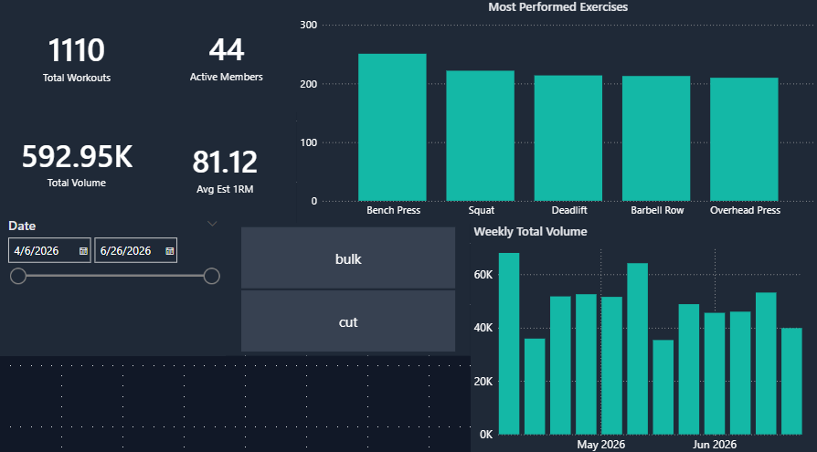
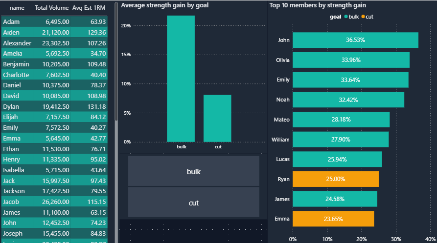
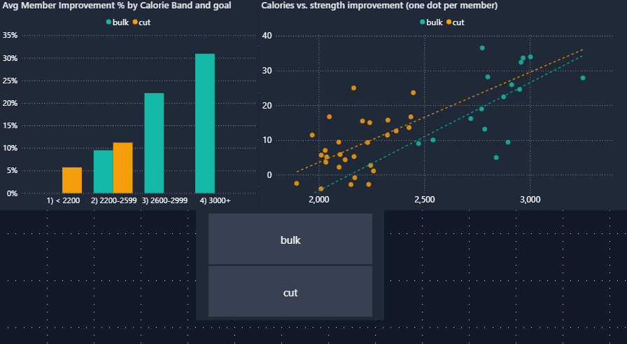
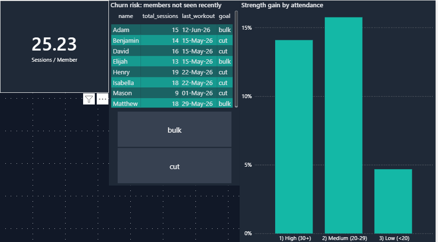
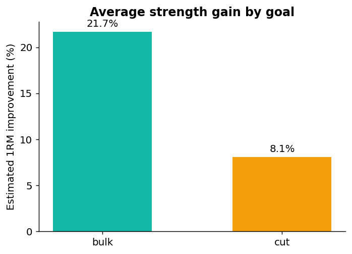
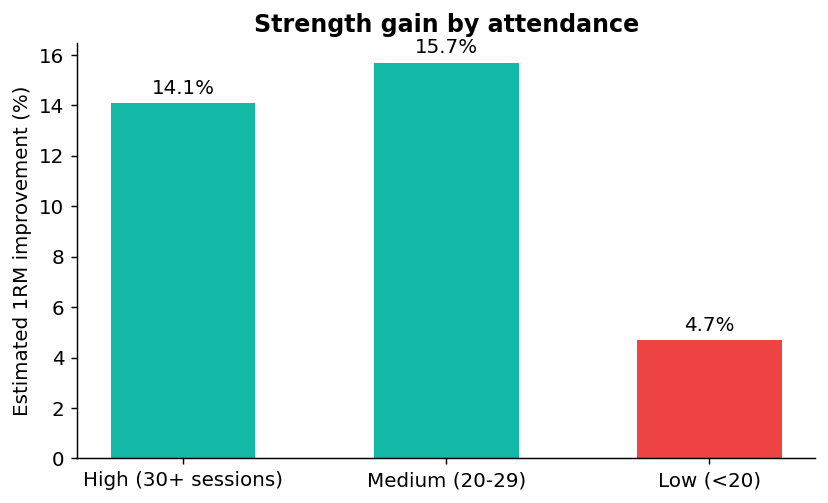
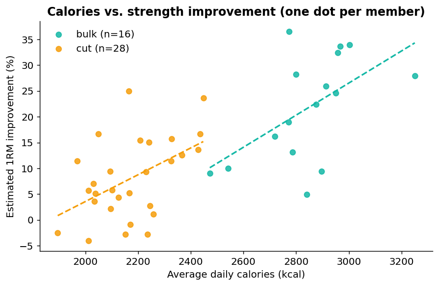
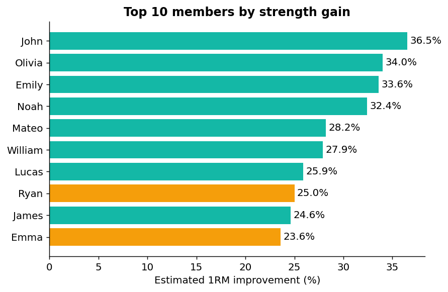
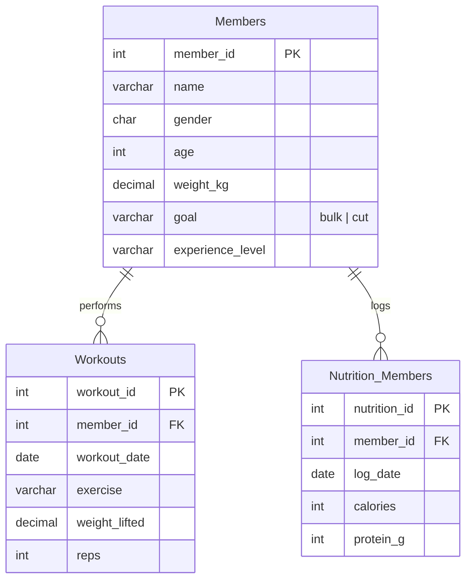

# 🏋️ Gym Performance Analytics

End-to-end analytics project: a normalized **SQL** database of gym members, workouts and nutrition, analysed with advanced SQL (CTEs, window functions, views), validated with automated data-quality checks, and presented in an interactive **Power BI** dashboard.

> **Business question:** *Which members are actually getting stronger — and what drives it: goal, calories or consistency?*

> ⚠️ **Data note:** the dataset is **simulated** (fixed seed, reproducible with `scripts/generate_seed_data.py`). Findings demonstrate the method; they are not real-world conclusions.

## Contents
[Dashboard](#dashboard) · [Key insights](#key-insights) · [Data model](#data-model) · [Metrics](#metrics) · [Quick start](#quick-start) · [Structure](#repository-structure) · [Limitations](#limitations--next-steps)

## Dashboard






## Key insights

| # | Finding | Evidence |
|---|---|---|
| 1 | **Bulkers gain strength ~2.7× faster than cutters** | avg 1RM gain 21.7 % (bulk, n=16) vs 8.1 % (cut, n=28) |
| 2 | **More calories ↔ more progress, even within the same goal** | correlation +0.55 (bulk), +0.49 (cut), computed per goal to avoid mixing groups |
| 3 | **Low attendance is the clearest drag** | < 20 sessions → 4.7 % gain vs 14–16 % for everyone else |
| 4 | **8 members are churn risks** | no session in the last 6 gym days |

<p>


</p>
<p>


</p>

Full query outputs are in [`results/`](results/).

## Data model



44 members · 1,110 workouts · 1,006 nutrition logs · 12 weeks · 5 compound lifts. See [`docs/data_dictionary.md`](docs/data_dictionary.md).

## Metrics

Averaging raw weights across different lifts (bench vs. deadlift) is misleading, so the project uses metrics that compare fairly:

- **Volume** = weight × reps
- **Estimated 1RM** (Epley) = weight × (1 + reps / 30)
- **Improvement %** = change in estimated 1RM, first vs. latest session, per member and lift (≥ 3 sessions)

## Quick start

**Fastest — no database server needed**
```bash
pip install -r requirements.txt
python scripts/run_pipeline.py
```
Builds a SQLite database from the SQL files, runs the data-quality checks (exits non-zero on failure), exports every query result to `results/` and re-renders the charts in `docs/images/`. The same pipeline runs in GitHub Actions on every push.

**On your own database** (SQL Server / MySQL 8+ / PostgreSQL)
1. Run `sql/01_schema.sql` → `02` → `03` → `04` → `05` in order.
2. *SQL Server:* put `GO` before each `CREATE VIEW` and replace `LIMIT n` with `SELECT TOP n`.

**Power BI**
1. Open `powerbi/Gym_Performance_Dashboard.pbix`, point the source at your database (or the CSVs in `data/`) and refresh.
2. Apply `powerbi/gym_theme.json` via *View → Themes → Browse for themes*.
3. Model, DAX measures and page layout: [`docs/powerbi_guide.md`](docs/powerbi_guide.md).

## Repository structure

```
Gym-Performance-Analytics/
├── README.md · LICENSE · requirements.txt
├── .github/workflows/ci.yml   # runs the pipeline on every push
├── data/                      # CSV exports (members, workouts, nutrition)
├── docs/
│   ├── data_dictionary.md
│   ├── powerbi_guide.md
│   └── images/                # charts used in this README
├── powerbi/
│   ├── Gym_Performance_Dashboard.pbix
│   ├── gym_theme.json
│   └── screenshots/
├── results/                   # CSV output of every analysis query
├── scripts/
│   ├── generate_seed_data.py
│   └── run_pipeline.py
└── sql/
    ├── 01_schema.sql          # tables, PK/FK, CHECK, UNIQUE, index
    ├── 02_seed_data.sql
    ├── 03_data_quality_checks.sql
    ├── 04_views.sql           # reusable metrics layer
    └── 05_analysis_queries.sql
```

## Limitations & next steps

- Simulated data and a small sample (44 members): correlations are indicative, not conclusive.
- Estimated 1RM is less reliable at high rep counts.
- Next: body-weight tracking over time, a significance test for the bulk/cut gap, and a churn-prediction model.

## Skills demonstrated

Relational design and constraints · data-quality validation · window functions and CTEs · metric design · avoiding confounding · reproducible pipeline and CI · Power BI modelling and DAX · documentation.
